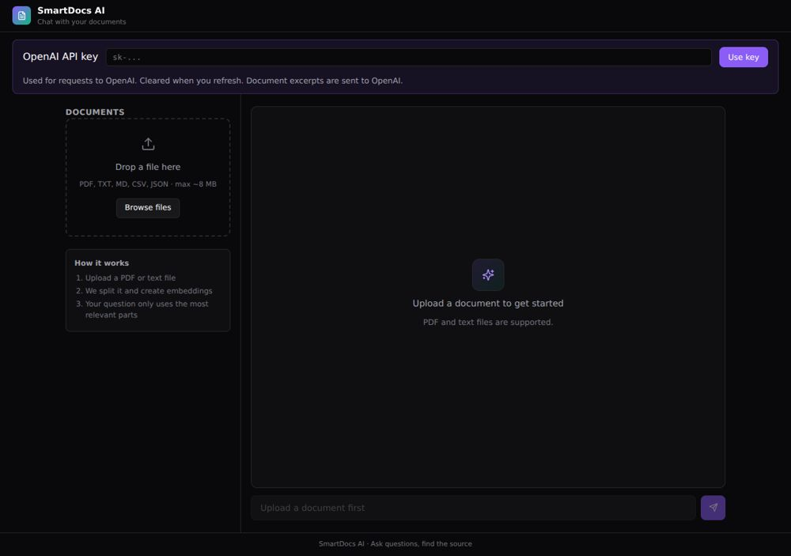

# SmartDocs AI



A React/Vite document chat prototype. Upload PDF, TXT, Markdown, CSV or JSON files, extract and chunk their text, retrieve relevant passages with embeddings, and stream a document-grounded answer.

## Run locally

Requires Node.js 20+ and npm:

```bash
npm ci
npm run dev
```

Open the URL printed by Vite, usually http://localhost:5173. To build locally: `npm run build`; to serve that build: `npm run preview`. No deployment is required.

## Features and data flow

- PDF text extraction with a bundled PDF.js worker
- Text chunks with overlap and cosine similarity retrieval
- OpenAI embeddings (`text-embedding-3-small`) and streaming chat (`gpt-4o-mini`)
- File type checks and an 8 MB upload limit

Enter your own OpenAI API key and click **Use key**. The key is held in memory and clears on refresh. Requests go directly to OpenAI and may incur usage charges. Document excerpts and questions are transmitted for embeddings/chat. The app no longer writes keys to localStorage; if you used an older version, remove the old `openai_key` entry from your browser storage. Documents and conversation state clear on refresh. There is no backend or server-side key storage.

## Structure

- `src/App.jsx` — application state, embedding and chat requests
- `src/components/` — upload and chat components
- `src/lib/pdf.js` — extraction and bundled worker
- `src/lib/rag.js` — chunking and ranking
- `src/lib/stream.js` — buffered SSE stream parsing
- `src/styles/` — application styling
- `tests/` — offline helper regression tests
- `docs/` — import provenance and validation notes

## Validation

```bash
node --test tests/*.test.js
npm run build
```

See `docs/VALIDATION.md` for actual results. Live paid API calls are not part of the import verification. Scanned PDFs need OCR, which this project does not implement. Use a server-side API gateway before offering this prototype as a shared public service.

## Source preservation

The original project and assets are retained in an import commit; original file checksums are in `docs/ORIGINAL_FILES.sha256`. The supplied notes mentioned MIT but included no LICENSE file; this import does not add a license grant.
